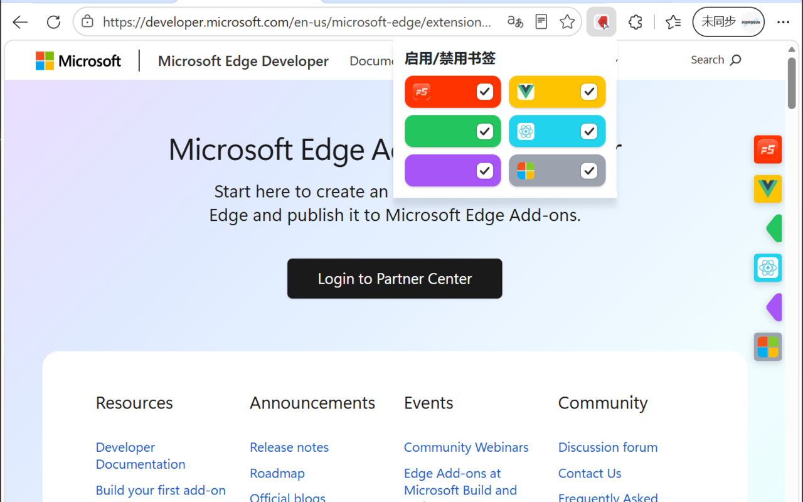
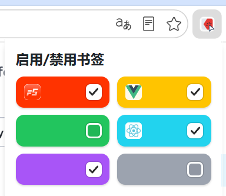
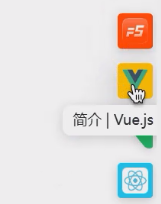
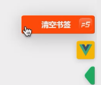

  

<h1 align="center">Simple Bookmarks</h1>

  <a href="README_zh-Hans.md">中文</a> ·
  <a href="README.md">English</a>

Halfway through a document and need to save your reading progress?

Do it with the fewest mouse clicks possible! Say goodbye to the tedious traditional bookmarking flow of "click star - select folder - save." This browser extension is specifically designed for reading long web pages, studying online documents, and browsing serialized articles.

## Core Features

1. **One-click Recording** Record or update your current progress with just a single right-click. No more tedious traditional bookmark saving/deleting processes;
2. **Quick Navigation** Jump back to your previous page instantly with a single left-click;
3. **Easy Cleanup** No longer need a record? Just drag the bookmark to the left to completely remove the saved URL, leaving no trace.

| Enable Bookmarks on Demand | Click to Jump | Drag to Clear |
| :---: | :---: | :---: |
|  |  |  |

## Installation

### Microsoft Edge

0. **Direct Link: [Simple Bookmarks - Microsoft Edge Addons](https://microsoftedge.microsoft.com/addons/detail/fcblgeedfjfmpehjimifonbidbojhmko)**
1. Go to the [Get Edge Extensions](https://microsoftedge.microsoft.com/addons/Microsoft-Edge-Extensions-Home) page;
2. Search for `Simple Bookmarks` (look for the developer `RISINGSUN517`), and click "Get";
3. Enjoy it!

### Google Chrome

*Refer to [Manual Installation](#manual-installation)

> ~~I'll publish it on the Chrome Web Store once I can afford the $5 registration fee (~~

### Manual Installation

> Applicable to Chromium-based browsers such as Microsoft Edge, Google Chrome, etc.

1. Download the latest `.zip` file from the [Releases](https://github.com/rs9c/simple-bookmarks/releases) page and extract it to any directory;
2. Open the browser's "Extension Management" page (e.g., `edge://extensions/`, `chrome://extensions/`);
3. Enable "Developer mode";
4. Click the "Load unpacked" button and select the extracted extension directory;

_For other browsers, feel free to download the source code, modify it as needed, and use it. Pull requests from capable folks are highly welcome_ :D

## Quick Start

0. Click the "Simple Bookmarks" extension icon and enable bookmarks in the extension menu as needed;
1. Open any web page;
2. `Right-click` the bookmark on the right side of the page, and the bookmark will record the current page's URL;
3. `Left-click` a bookmark on the right side, and the page will jump to the previously recorded URL; use `middle-click` or `Ctrl + left-click` to open the page in a new tab;
4. Drag bookmarks up and down to adjust their positions;
5. `Drag a bookmark to the left` to clear its recorded URL.

## Design Philosophy

> **Simplicity is the ultimate sophistication.** Eliminating tons of unnecessary mouse operations.

When reading a document and wanting to temporarily save your progress, let's review the normal workflow:

1. Click the star icon on the right side of the browser's address bar;
2. Select "All Bookmarks" as the folder;
3. Click "Save";

Next time you want to continue reading:

1. Move your mouse to the right side of the bookmarks bar and expand the "All Bookmarks" folder;
2. Find the previously saved bookmark and click it;

After reading another section and wanting to update your progress:

1. Click the star icon on the right side of the browser's address bar;
2. Select "All Bookmarks" as the folder;
3. Click "Save";
4. Move your mouse to the right side of the bookmarks bar and expand the "All Bookmarks" folder;
5. Find the old bookmark, right-click, and delete it;

> _Count how many times you had to click the mouse?_

One day, I was struck by a sudden ~~fit of laziness~~ inspiration and came up with the idea to build a browser extension. I briefly sketched it out in my head (which is exactly how it looks now), thinking that placing a bookmark should be as effortless as putting a physical bookmark in a paper book—which translates to just a simple mouse click when browsing the web.

With the requirements clear, I quickly looked up how to make a Chrome extension: a manifest.json, plus a few HTML and JS files... Piece of cake, right? I figured I could hand-code it in about a week (or so).

But ~~laziness struck again~~ times have changed. Since the functionality wasn't that complex anyway, I just spent one evening feeding the idea in my head to an AI Agent, and boom—this extension was born. (Though I did draw the icon myself.)

From now on, to temporarily save your reading progress: **one** right-click;

To return to your last progress: **one** left-click;

To update your progress: **one** right-click;

To clear the bookmark after finishing: just a quick drag.

> _Feels good, doesn't it?_

## Acknowledgements

* [Fluent UI System Icons](https://github.com/microsoft/fluentui-system-icons) Used their SVG when designing the icon.

## License

This project is licensed under the MIT License. See [LICENSE](LICENSE) for details.

Copyright © 2026 RISINGSUN517