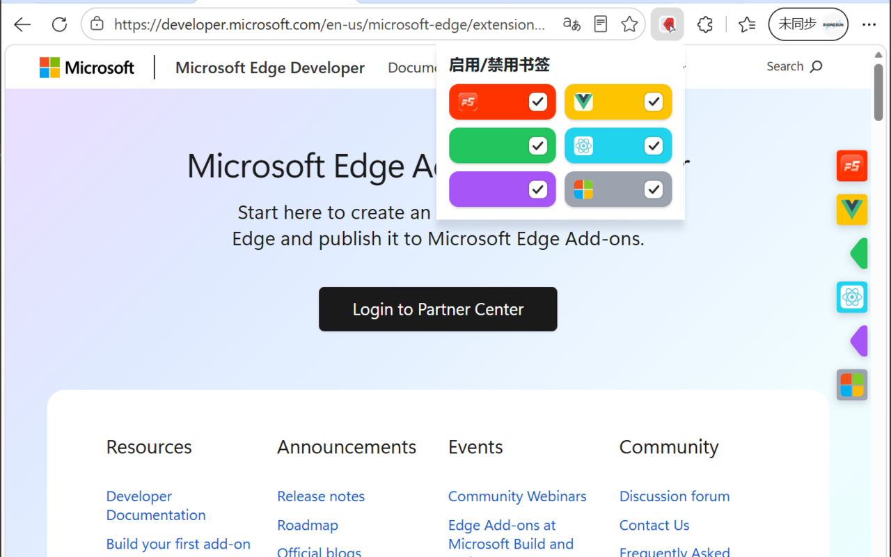
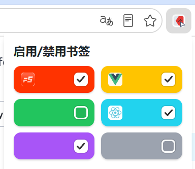
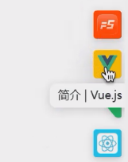
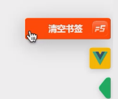

  

<h1 align="center">简单の书签</h1>

  <a href="README_zh-Hans.md">中文</a> ·
  <a href="README.md">English</a>

读文档读到一半，需要记录当下阅读进度？

用最少的鼠标点击即刻完成！告别繁琐的“点击星号-选择文件夹-保存”的传统书签流程，此浏览器扩展专为长网页阅读、在线文档研读、连载文章浏览等场景设计。

## 核心功能

1. **一键记录** 只需右键单击一下即可记录/更新当下进度，无需繁琐的传统书签保存/删除流程；
2. **快捷跳转** 左键单击即刻跳转到之前的页面；
3. **轻松清理** 不再需要的记录，只需向左侧拽出书签，即可将其所记录的 URL 彻底清除，不留痕迹。

| 按需启用书签 | 单击即可跳转 | 拖动即可清除 |
| :---: | :---: | :---: |
|  |  |  |

## 安装扩展

### Microsoft Edge

0. **直接前往：[简单的书签 - Microsoft Edge Addons](https://microsoftedge.microsoft.com/addons/detail/fcblgeedfjfmpehjimifonbidbojhmko)**
1. 前往 [获取 Edge 扩展](https://microsoftedge.microsoft.com/addons/Microsoft-Edge-Extensions-Home) 页面；
2. 搜索 `简单的书签` 或 `Simple Bookmarks`（认准开发者`RISINGSUN517`），点击“获取”；
3. Enjoy it!

### Google Chrome

*参考 [手动安装](#手动安装) 

> ~~什么时候我能交的起 $5 注册费我就上架（~~

### 手动安装

> 适用于 Microsoft Edge、Google Chrome 等基于 Chromium 内核的浏览器。

1. 在 [Releases](https://github.com/rs9c/simple-bookmarks/releases) 页面下载最新版本的 `.zip` 文件，并解压到任意目录；
2. 打开浏览器的“扩展管理”页面（如`edge://extensions/`、`chrome://extensions/`）；
3. 启用“开发者模式”；
4. 点击“加载已解压的扩展程序”按钮，选择解压后的扩展目录；

_对于其他浏览器，可自行下载源码进行适当修改后使用。有能力者欢迎 Pull Request_ :D

## 快速上手

0. 点击“简单的书签”扩展图标，在扩展菜单中按需启用书签；
1. 打开任意网页；
2. `鼠标右键单击`页面右侧的书签，书签会记录当前页面的URL；
3. `鼠标左键单击`右侧的某个书签，页面将跳转到之前记录的URL；使用`鼠标中键单击`或`Ctrl+鼠标左键单击`可在新标签页中打开页面；
4. 上下拖动书签可调整位置；
5. `向左拽出`某个书签，可将其所记录的URL清除。

## 设计の哲♂学

> **大道至简** 免去了大量不必要的鼠标操作

读文档的时候想临时记录一下阅读进度，回顾一下正常的操作：

1. 点击浏览器路径栏右侧的星号图标；
2. 文件夹选择“所有书签”；
3. 点击“保存”；

下次想接着看时：

1. 鼠标移到书签栏右边，展开“所有书签”文件夹；
2. 找到之前保存的书签，点击它；

又读了一段文档，想更新一下阅读进度：

1. 点击浏览器路径栏右侧的星号图标；
2. 文件夹选择“所有书签”；
3. 点击“保存”；
4. 鼠标移到书签栏右边，展开“所有书签”文件夹；
5. 找到旧的书签，右键-删除；

> _数数鼠标点击了多少次？_

某一天突然~~懒癌~~犯了，突然萌生了做一个浏览器扩展的想法，在脑子里简单构思了一下（就是现在的样子），想着像读纸质书一样，放个书签就是随手的事——换做浏览网页就是一次简单的鼠标操作。

需求明确了，简单查了一下如何制作Chrome扩展：一个manifest.json，再来几个html和js……这不简简damn damn？差不多手搓一个星期(?)就能搞定。

但是 ~~懒癌又双叒叕犯了~~ 时代变了。反正功能没多复杂，用了一个晚上的时间，把脑子里的想法直接交给 AI Agent ，然后诞生了这个扩展。（不过图标还是自己画的）

以后临时记录一下阅读进度：**一次**鼠标右键；

回到上次进度： **一次**鼠标左键；

更新一下进度： **一次**鼠标右键；

读完文档清除书签：随手拖一下。

> _这回爽了吧?_

## 鸣谢

* [Fluent UI System Icons](https://github.com/microsoft/fluentui-system-icons) 设计 icon 时用了这里的 svg

## 版权许可

本项目采用 MIT 许可证授权，详见 [LICENSE](LICENSE) 。

Copyright © 2026 RISINGSUN517